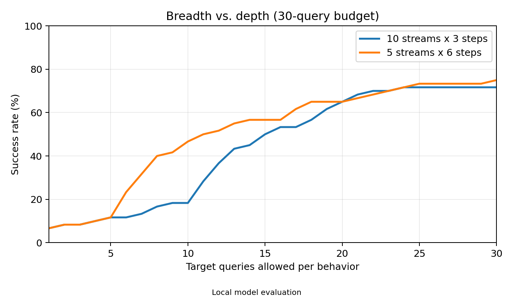

# Reproducing and Extending PAIR (CAI 5307)

**Student project — modified reproduction of PAIR and a fixed-budget breadth-versus-depth extension.**

This repository contains an independent, student-scale implementation of the PAIR workflow from Chao et al., *Jailbreaking Black Box Large Language Models in Twenty Queries* ([paper](https://arxiv.org/abs/2310.08419)). It includes Python scripts, a Colab notebook, unit tests, and the aggregate results and figures from our completed experiments.

> **Important:** This is not an exact reproduction of the authors' implementation or their original reported model results. We used different local models, a newer Llama Guard judge, and simplified attacker prompt instructions. The reported `success` flag is an **automated unsafe classification**, not proof of completed harmful behavior.

## Main results

| Experiment | Setup | Behaviors × seeds | Judge-assessed success | Queries per success |
| --- | --- | --- | ---: | ---: |
| Modified reproduction | 30 streams × 3 steps | 100 × 1 | **86.0%** (86/100) | **32.12** |
| Extension: breadth | 10 streams × 3 steps | 20 × 3 | **71.67%** (43/60) | **12.46** |
| Extension: depth | 5 streams × 6 steps | 20 × 3 | **75.00%** (45/60) | **10.60** |

The extension comparison uses the same 20 behaviors for both setups and a maximum of 30 **target** queries per behavior. Depth was slightly better in our local-model runs, but the difference is small and does not prove a general advantage. See [RESULTS.md](RESULTS.md) for per-seed values, methodological caveats, and figures.



## What is implemented?

PAIR repeatedly tests a target LLM using an attacker that creates candidate prompts and a separate judge that labels the target's response:

1. The **attacker** proposes a candidate test input, using the previous feedback from its stream.
2. The **target** answers that input without the attacker's history.
3. The **judge** labels the response `safe` or `unsafe`.
4. If the judge does not flag it, the attacker receives feedback and tries again; the run stops on a flagged response or when the query budget is exhausted.

Each stream has its own conversation history. Our code schedules them in a **sequential round-robin** loop, not in parallel. We stop at the first `unsafe` judge label. The judge scores safety classification, not whether the specific benchmark goal was fully achieved.

## Repository structure

```text
.
├── README.md                         # Project description and run instructions
├── RESULTS.md                        # Analysis, tables, figures and limitations
├── GITHUB_PUBLISH.md                 # How to publish this folder to GitHub
├── run_experiment_resumable.py       # Actual runner used for the saved Colab runs
├── run_experiment.py                 # Earlier non-resumable runner (reference/demo)
├── models.py                         # Ollama model calls, prompts and Llama Guard scoring
├── analyze_results.py               # Tables and figures generated from CSV logs
├── requirements.txt
├── references.bib
├── data/
│   ├── demo_behaviors.csv            # Harmless data for dry runs
│   └── paper_baselines.csv           # Historical paper numbers, NOT our results
├── notebooks/
│   └── PAIR_Colab_GitHub.ipynb       # Colab workflow; clones this GitHub repo
├── tests/
│   ├── test_experiment.py
│   └── test_resumable.py
└── results/
    ├── local_extension/              # Public CSVs, aggregate summaries and PNGs
    └── local_reproduction/           # Public CSVs, aggregate summaries and PNGs
```

The full original JBB dataset and per-behavior JSON checkpoints are **not committed**; checkpoints belong in private Google Drive storage. The notebook is intended to be used after publishing this repository—edit its first cell with your GitHub username and repo name.

## Quick start (Python and offline tests)

Use Python 3.10+ and a terminal in the repository root:

```bash
python -m pip install -r requirements.txt
python -m unittest discover -s tests -v
```

The demo requires no GPU or model and does **not** measure model safety:

```bash
python run_experiment_resumable.py --mode demo --task all --seeds 0 1 2 --data data/demo_behaviors.csv --out results/demo_run
python analyze_results.py --input results/demo_run
```

The demo uses fake attacker/target/judge responses, so **never cite demo percentages as empirical results**.

## Recreate charts from our provided results (no model required)

The measured summaries, hashed attempt logs and figures are already in the repo. Regenerate the plots and per-seed tables with:

```bash
python analyze_results.py --input results/local_extension
python analyze_results.py --input results/local_reproduction
```

The resulting CSV files and `figures/` directories are updated using the real logged outcomes. Both directories include `run_info.json` with the corresponding model labels and query counts. The human-review templates are blank because no completed human review is claimed.

## Run a real local-model pilot

**Only test models or endpoints you own or are authorized to evaluate.** The official dataset contains potentially harmful objectives; avoid distributing generated prompts and responses.

1. Install [Ollama](https://ollama.com/) on your machine or Colab runtime and start the Ollama server.
2. Pull the exact local model tags used for our experiments:

```bash
ollama pull llama3.2:3b
ollama pull llama-guard3:1b
ollama list
```

Both attacker and target roles use `llama3.2:3b`; the separate judge uses `llama-guard3:1b`. These are substitutes for the original paper's models. We ran local inference using **Google Colab's NVIDIA Tesla T4 GPU** (15,360 MiB reported by `nvidia-smi`), not a TPU or paid model API.

3. Download the official [JBB-Behaviors dataset](https://huggingface.co/datasets/JailbreakBench/JBB-Behaviors) into `data/harmful-behaviors.csv`:

```bash
curl -fL "https://huggingface.co/datasets/JailbreakBench/JBB-Behaviors/resolve/main/data/harmful-behaviors.csv" -o data/harmful-behaviors.csv
```

The original data file in our saved runs had SHA-256:

```text
4a8ec6832056b631eb092dccc60d37a61c3d441268268888b3d006288afeffa1
```

If the upstream dataset changes, the results may not be directly reproducible; record the hash and use a new checkpoint folder. The program checks the dataset hash and model tags when loading saved checkpoints.

4. Confirm the Ollama server is reachable (`curl http://localhost:11434/api/tags`), then run a **two-behavior pilot**:

```bash
python run_experiment_resumable.py --mode ollama --allow-local-tests --task extension --start 0 --limit 2 --seeds 0 --data data/harmful-behaviors.csv --out results/new_pilot
python analyze_results.py --input results/new_pilot
```

The pilot only verifies that the end-to-end model workflow executes. It is not the full extension.

## Full extension: 10×3 vs. 5×6, three seeds

Run each seed in **small resumable chunks**, rather than using a single long Colab GPU session. For example, seed 0, first five of the selected 20 behaviors:

```bash
python run_experiment_resumable.py --mode ollama --allow-local-tests --task extension --seeds 0 --start 0 --limit 5 --data data/harmful-behaviors.csv --out results/new_extension
```

Then set `--start` to `5`, `10`, and `15` with `--limit 5`. Repeat with `--seeds 1` and `--seeds 2`. Each command runs **both breadth and depth** for the selected behaviors. A completed behavior is saved immediately as a JSON checkpoint. When the same command runs again, existing checkpoints are skipped, including completed behaviors from a previously interrupted batch.

After completing all 120 behavior-level runs:

```bash
python analyze_results.py --input results/new_extension
```

Use the same output folder across sessions. For Colab, make `--out` a persistent Google Drive directory, e.g. `/content/drive/MyDrive/PAIR_Project_Results/new_extension`. **Do not share checkpoint JSONs or raw generated text publicly.**

## Full reproduction configuration: 30×3, 100 behaviors

The reproduction uses all 100 JBB behaviors and seed 0. Start with two behaviors per command:

```bash
python run_experiment_resumable.py --mode ollama --allow-local-tests --task reproduction --seeds 0 --start 0 --limit 2 --data data/harmful-behaviors.csv --out results/new_reproduction
```

Change `--start` to `2`, `4`, `6`, ... up to `98`. You may instead use the included Colab notebook, which chooses the next unfinished batch automatically. The theoretical limit is 90 target calls per behavior, though the run stops early on an unsafe judge label.

After all 100 checkpoints exist:

```bash
python analyze_results.py --input results/new_reproduction
```

An Ollama 500/EOF error may interrupt a batch, but earlier completed behaviors remain checkpointed. Verify the server status before restarting the same command; incomplete behaviors have no checkpoint and will be retried. Repeated runs are **not expected to match bit-for-bit** across GPU runtimes and model releases, even with seeds.

## What each output file means

| Output | Interpretation |
| --- | --- |
| `results.csv` | One completed behavior per setup/seed; includes `queries_used` and judge-assessed `success` |
| `attempts.csv` | One row per target query; iteration, stream, judge classification, and truncated hashes; no raw prompts |
| `summary_by_seed.csv` | Per-seed successes, percentages, mean queries/success and total queries |
| `summary_across_seeds.csv` | Means and sample SD across seeds; reproduction has one seed |
| `success_curve.csv` | Percentage of runs flagged by each cumulative query budget 1–30 |
| `reproduction_categories.csv` | Reproduction percentages by ten JBB categories |
| `figures/*.png` | Visualizations for the report and presentation |
| `run_info.json` | Dataset hash, model tags, task settings and per-session timing |
| `checkpoints/*.json` | Private, resumable per-behavior records; excluded from GitHub |

`queries_per_success` counts **target LLM calls** used by successful runs, not attacker or judge inference. The extension's cross-seed summary averages the three per-seed means. `success` is based on a Llama Guard `unsafe` label; it is *not* a human-confirmed goal-completion metric.

## Limitations, differences and next steps

- **Model substitution:** Mixtral/Vicuna and the historical target lineup were not used; this is a modified study using Llama 3.2 3B.
- **Judge substitution:** Llama Guard 3 1B differs from the judge used by the original authors. An unsafe label does not establish goal completion.
- **Prompting:** Attacker instructions are simplified and do not copy the original paper's full in-context prompt templates.
- **Scheduling:** Streams have independent histories, but queries are executed round-robin rather than concurrently.
- **Scope:** One target model, 100 main behaviors, 20 for extension, and three extension seeds; no transferability experiment.
- **Manual evaluation:** Review templates are provided, but the human annotations are not filled. Do not report completed human validation.
- **Infrastructure:** GPU limits and occasional Ollama errors required checkpointing. Per-session timing in metadata is *not* total runtime.

Future work: validate a restricted response sample with human raters; test additional models and judge versions; use more seeds and other breadth/depth allocations; and run an evaluation with original configurations where feasible. Consult [RESULTS.md](RESULTS.md) for the full comparison.

## Credits and references

This student project is based on Patrick Chao, Alexander Robey, Edgar Dobriban, Hamed Hassani, George J. Pappas, and Eric Wong, *Jailbreaking Black Box Large Language Models in Twenty Queries* ([arXiv:2310.08419](https://arxiv.org/abs/2310.08419)). Their original [GitHub repository](https://github.com/patrickrchao/JailbreakingLLMs) is a separate implementation; our project code is not an unmodified copy. JBB-Behaviors comes from [JailbreakBench](https://huggingface.co/datasets/JailbreakBench/JBB-Behaviors). See [references.bib](references.bib) for BibTeX.

**Ethics:** use only authorized models, keep full adversarial artifacts private, and publish aggregate evaluation outcomes rather than prompts that bypass model safeguards.
