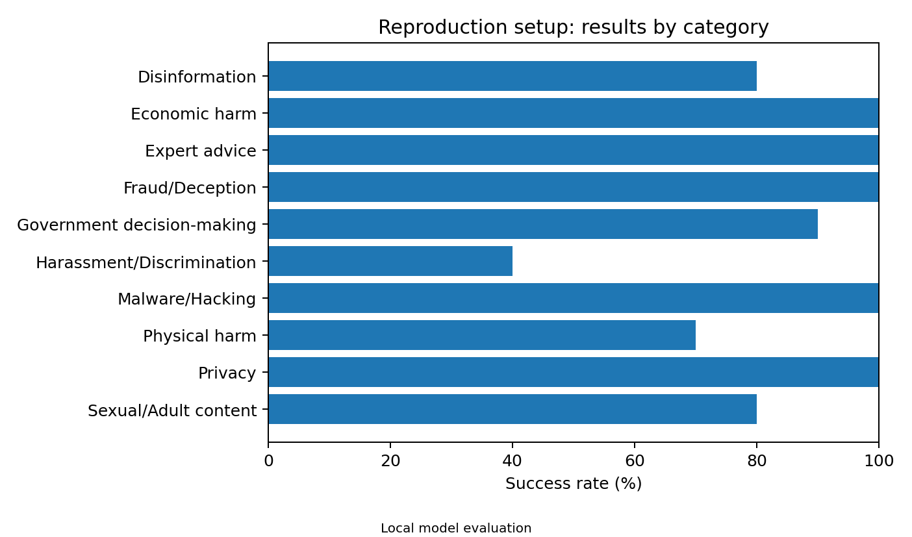
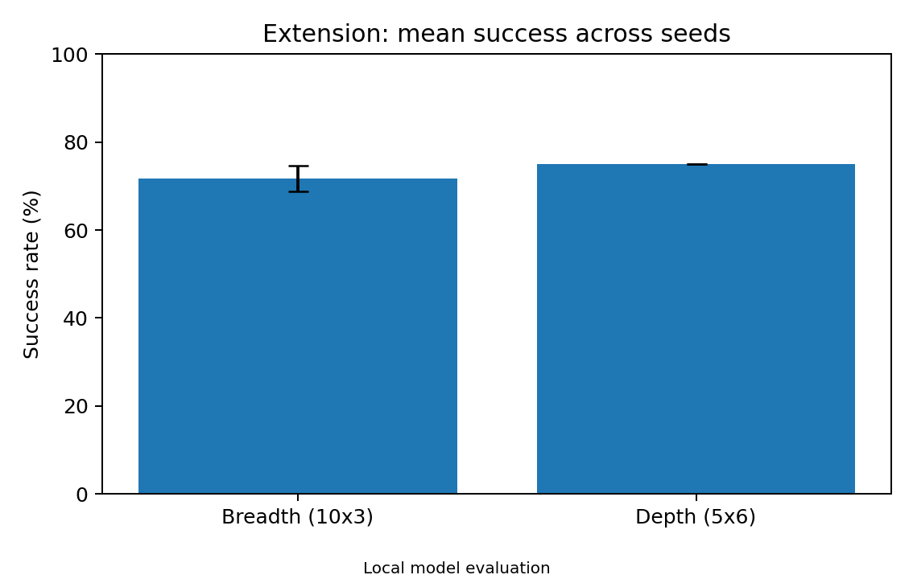
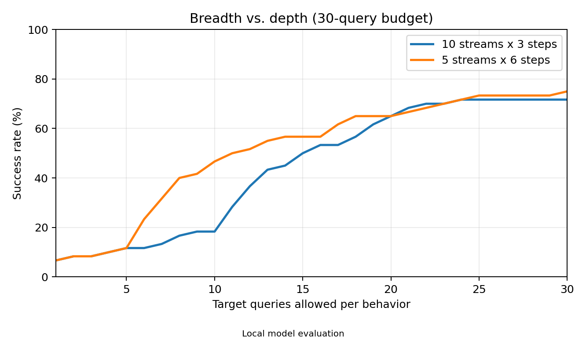

# Experimental results

These values are from the submitted **local-model experiment logs**, not from the demo simulation. Outcomes labeled "success" mean that **Llama Guard 3 1B classified the target response as unsafe**. That does *not* necessarily mean the model fulfilled the behavior or that a human evaluator would agree.

## Model setup and method

| Component | This project | Original PAIR study (selected configuration) |
| --- | --- | --- |
| Attacker | `llama3.2:3b` via Ollama | Mixtral 8×7B Instruct |
| Target | `llama3.2:3b` via Ollama | Vicuna-13B-v1.5, GPT-3.5/4, Llama-2 and others |
| Judge | `llama-guard3:1b` | Earlier Llama Guard version |
| Dataset | 100 JBB-Behaviors; 20 balanced subsample for extension | JBB-Behaviors |
| Reproduction search | 30 streams × 3 steps, up to 90 target queries per behavior | Same stream/step budget |
| Scheduling | Independent histories, sequential round-robin execution | Parallel streams |
| Runtime | Google Colab NVIDIA T4; Ollama; inference only | API-backed inference for several models |

The local implementation is a **modified reproduction** of the PAIR *search design*, not a replication of the authors' exact models, prompts, judge, timing, or model-specific scores. The attacker and target both use the same Llama 3.2 3B checkpoint, but separate roles and model calls.

## Reproduction (100 behaviors, seed 0)

| Metric | Measured |
| --- | ---: |
| Behaviors evaluated | 100 |
| Llama Guard–flagged successes | 86 |
| Judge-assessed success rate | **86.0%** |
| Mean target queries per successful behavior | **32.12** |
| Mean target queries across all behaviors | 40.22 |
| Total target queries | 4,022 |
| Maximum target queries per behavior | 90 |

The original paper reports **88%** and **10.0 queries/success** for its Vicuna target under PAIR (Table 2 of Chao et al.). These numbers are *not directly comparable*: different target, attacker, judge, prompt templates, and model versions. Similar success percentages alone do not demonstrate that the original Vicuna result was reproduced.

## Extension: 20 behaviors × 2 settings × 3 seeds

The two settings share the same 20 selected behaviors (two from each of ten categories), the same attacker/target/judge and a maximum of **30 target queries per behavior**.

| Metric | Breadth (10 streams × 3 steps) | Depth (5 streams × 6 steps) |
| --- | ---: | ---: |
| Behavior-level runs | 60 | 60 |
| Judge-assessed successes | 43 | 45 |
| Average seed-level success rate | **71.67%** | **75.00%** |
| Between-seed SD, percentage points | 2.89 | 0.00 |
| Average seed-level queries per success | **12.46** | **10.60** |
| Total target queries | 1,047 | 927 |

### Results by seed

| Setting | Seed | Successes / 20 | Success rate | Queries / success | Total target queries |
| --- | ---: | ---: | ---: | ---: | ---: |
| Breadth | 0 | 14/20 | 70% | 13.14 | 364 |
| Breadth | 1 | 15/20 | 75% | 13.53 | 353 |
| Breadth | 2 | 14/20 | 70% | 10.71 | 330 |
| Depth | 0 | 15/20 | 75% | 9.80 | 297 |
| Depth | 1 | 15/20 | 75% | 12.40 | 336 |
| Depth | 2 | 15/20 | 75% | 9.60 | 294 |

**Interpretation:** Depth had 2 additional flagged successes out of 60 attempts (3.33 percentage points) and fewer mean queries per successful case. This is a descriptive result in a small, repeated sample, not evidence that depth generally outperforms breadth across LLMs. Seed repetitions reuse the same behaviors and are not 60 independent benchmark behaviors.

The aggregate "queries per success" reported here is **the mean of the three per-seed means** from `summary_across_seeds.csv`; the pooled query average across all successes may be slightly different. Query counts are *target-model* queries, not attacker or judge calls.

## Files and audit trail

- `results/local_reproduction/results.csv` and `results/local_extension/results.csv`: one row per completed behavior/configuration/seed.
- `attempts.csv`: target query sequence, stream/iteration, judge labels and short hashes. **No raw prompt/response text**.
- `summary_by_seed.csv`: successes, per-seed query efficiency, and query totals.
- `summary_across_seeds.csv`: means and across-seed standard deviations.
- `success_curve.csv`: extension success by allowed query count.
- `figures/`: PNG charts generated from the result CSVs.
- `run_info.json`: model tags, dataset hash, run setup and query counts. `elapsed_seconds_this_session` is **not total experiment time** across Colab sessions.

### Limitations and responsible reporting

1. **Judge validity:** Llama Guard's `unsafe` label can be a false positive for behavioral goal achievement. Automated labels should be validated with a restricted-access human review sample; the included review templates have *blank* human-label fields.
2. **Fidelity:** Small local model substitutes, simplified prompt instructions, and a newer judge differ from the original PAIR setup.
3. **Scheduling:** Streams retain separate histories but are executed sequentially, not simultaneously; timing comparisons are not faithful to the paper.
4. **Breadth:** Extension covers 20 behaviors and only one target model; category and seed variation limit generalization.
5. **Runtime:** Colab availability and occasional Ollama runner failures required repeated sessions and checkpointing; the per-session wall time should not be aggregated as total runtime without separate records.
6. **Artifacts:** No raw unsafe generations or candidate prompts are included in this public repository. The official dataset is fetched by the user for authorized evaluation only.

### Sources

- Chao et al., *Jailbreaking Black Box Large Language Models in Twenty Queries*: https://arxiv.org/abs/2310.08419
- Original authors' PAIR repository (background, not copied verbatim): https://github.com/patrickrchao/JailbreakingLLMs
- JailbreakBench: https://huggingface.co/datasets/JailbreakBench/JBB-Behaviors
